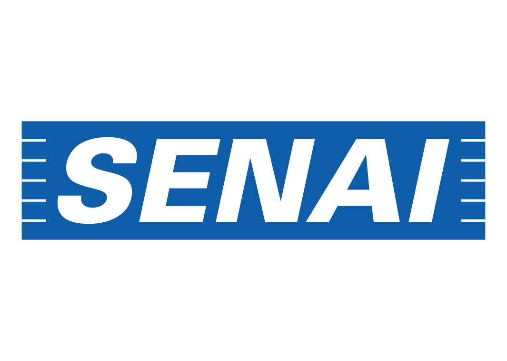

<!-- BANNER PRINCIPAL -->

  

<!-- SOBRE MIM -->

## Sobre mim

Desenvolvedor Web e graduando em Engenharia de Software pela UNINTER, com formação em desenvolvimento Front-end pelo SENAI.

Atuo no desenvolvimento de websites institucionais, landing pages e aplicações web, desde a construção de interfaces até a integração de funcionalidades e publicação.

Tenho experiência com projetos comerciais e utilizo HTML, CSS, JavaScript, Python e Django, direcionando minha formação para o desenvolvimento Full Stack.

<!-- CONTATO RAPIDO -->
## Contato Rápido

  &nbsp;&nbsp;&nbsp;&nbsp;&nbsp;
  &nbsp;&nbsp;&nbsp;&nbsp;&nbsp;
  

<!-- TECH STACK -->

## Tech Stack

<h3>Linguagens e frameworks</h3>

<h3>Ferramentas e plataformas</h3>

<h3>Estudando</h3>

<!-- PROJETOS EM DESTAQUE -->

## Projetos em destaque

<h3>Eletrotécnica Marinelli</h3>
      

      Website institucional responsivo com formulários integrados ao Google Apps Script,
      armazenamento de dados em planilhas e notificações automatizadas por e-mail.

      

      
      

<h3>Django Cafeteria</h3>
      

      Aplicação web desenvolvida com Python e Django, voltada à apresentação
      de um catálogo de produtos de uma cafeteria.

      

      

<h3>Construir com Aço</h3>
      

      Landing page desenvolvida para apresentação do programa de parcerias comerciais
      da Ferrobran Estruturas Metálicas.

      

      

<h3>Canela Engenharia Elétrica</h3>
      

      Website institucional voltado à apresentação de serviços de engenharia elétrica
      e captação de potenciais clientes.

      

      

<!-- Formação -->

## Formação

<h3 align="center">Engenharia de Software</h3>

Centro Universitário Internacional — UNINTER

<h3 align="center">Programador Front-end</h3>

Firjan SENAI — Niterói

<h3 align="center">Programação em Python</h3>

SENAC

<!-- CONTATOS -->

## Contato

  
  
  
  

