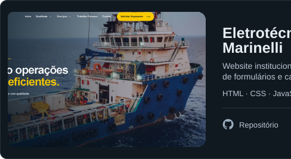
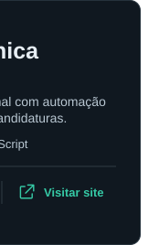
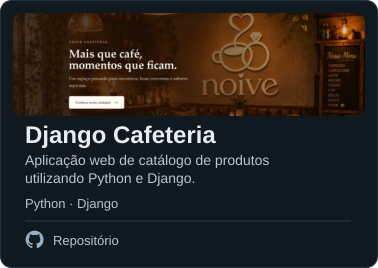
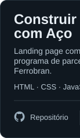
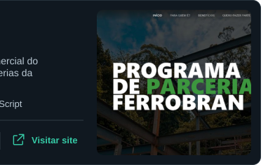
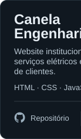
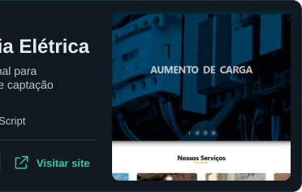

<!-- BANNER PRINCIPAL -->

  

<!-- SOBRE MIM -->

## Sobre mim

Desenvolvedor Web e graduando em Engenharia de Software pela UNINTER, com formação em desenvolvimento Front-end pelo SENAI.

Atuo no desenvolvimento de websites institucionais, landing pages e aplicações web, desde a construção de interfaces até a integração de funcionalidades e publicação.

Tenho experiência com projetos comerciais e utilizo HTML, CSS, JavaScript, Python e Django, direcionando minha formação para o desenvolvimento Full Stack.

<!-- CONTATO RAPIDO -->
## Contato Rápido

  &nbsp;&nbsp;&nbsp;&nbsp;
  &nbsp;&nbsp;&nbsp;&nbsp;
  

<!-- TECH STACK -->

## Tech Stack

  &nbsp;&nbsp;
  &nbsp;&nbsp;
  

<!-- PROJETOS EM DESTAQUE -->

## Projetos em destaque

<!-- Layout editorial assimétrico. Os recortes SVG preservam links independentes. -->

  

  

<!-- Formação -->

## Formação

  

  &nbsp;
  

<!-- CONTATOS -->

## Contato

  &nbsp;
  &nbsp;
  &nbsp;
  

