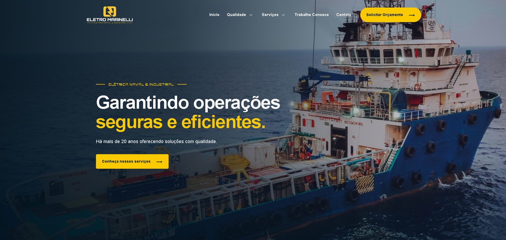
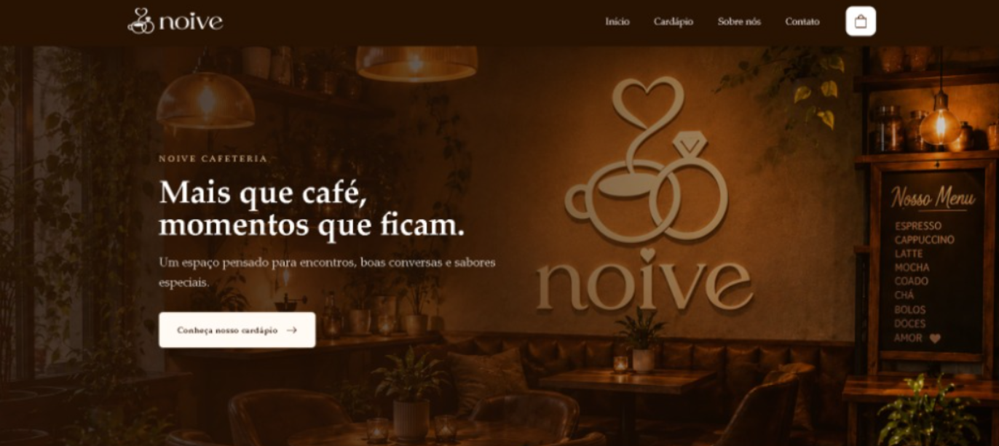

<!-- BANNER PRINCIPAL -->

  

<!-- SOBRE MIM -->

## Sobre mim

Desenvolvedor Web e graduando em Engenharia de Software pela UNINTER, com formação em desenvolvimento Front-end pelo SENAI.

Atuo no desenvolvimento de websites institucionais, landing pages e aplicações web, desde a construção de interfaces até a integração de funcionalidades e publicação.

Tenho experiência com projetos comerciais e utilizo HTML, CSS, JavaScript, Python e Django, direcionando minha formação para o desenvolvimento Full Stack.

<!-- CONTATO RAPIDO -->
## Contato Rápido

  &nbsp;&nbsp;&nbsp;&nbsp;
  &nbsp;&nbsp;&nbsp;&nbsp;
  

<!-- TECH STACK -->

## Tech Stack

  &nbsp;&nbsp;
  &nbsp;&nbsp;
  

<!-- PROJETOS EM DESTAQUE -->

## Projetos em destaque

<table align="center">
  <tr>
    <td width="50%" align="center" valign="top">
      
      <h3>Eletrotécnica Marinelli</h3>
      
Website institucional com formulários automatizados, envio de e-mails e gestão de candidaturas.

      

      

        
        
      

    </td>
    <td width="50%" align="center" valign="top">
      
      <h3>Django Cafeteria</h3>
      
Aplicação web de catálogo de produtos, desenvolvida com Python e Django.

      

      

        
      

    </td>
  </tr>
  <tr>
    <td width="50%" align="center" valign="top">
      
      <h3>Construir com Aço</h3>
      
Landing page para apresentação do programa de parcerias da Ferrobran Estruturas Metálicas.

      

      

        
      

    </td>
    <td width="50%" align="center" valign="top">
      
      <h3>Canela Engenharia Elétrica</h3>
      
Website institucional para apresentação de serviços elétricos e geração de contatos comerciais.

      

      

        
      

    </td>
  </tr>
</table>

<!-- Formação -->

## Formação

<h3 align="center">Engenharia de Software</h3>

Centro Universitário Internacional — UNINTER

<h3 align="center">Programador Front-end</h3>

Firjan SENAI — Niterói

<h3 align="center">Programação em Python</h3>

SENAC

<!-- CONTATOS -->

## Contato

  
  
  
  

