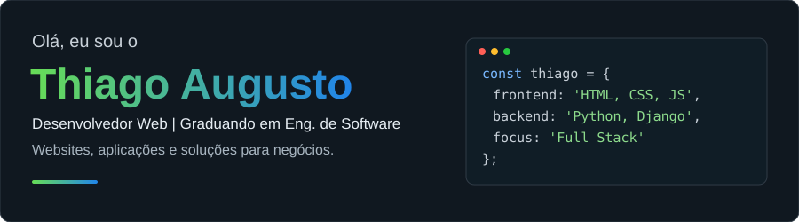

  

## Sobre mim

Desenvolvedor Web e graduando em Engenharia de Software pela UNINTER, com formação em desenvolvimento Front-end pelo SENAI.

Atuo no desenvolvimento de websites institucionais, landing pages e aplicações web, desde a construção de interfaces até a integração de funcionalidades e publicação.

Tenho experiência com projetos comerciais e utilizo HTML, CSS, JavaScript, Python e Django, direcionando minha formação para o desenvolvimento Full Stack.

## Tech Stack

### Front-end

### Back-end

### Ferramentas

### Atualmente estudando

<h2>Projetos em destaque</h2>

<table>
  <tr>
    <td width="35%">
      
    </td>
    <td width="65%">
      <h3>Eletrotécnica Marinelli</h3>
      

        Website institucional responsivo com
        formulários integrados ao Google Apps Script,
        armazenamento de dados em planilhas e
        notificações automatizadas por e-mail.
      

      
      

        <a href="https://github.com/thiagoaugustx/website-eletrotecnica-marinelli">Repositório</a>
        |
        <a href="https://thiagoaugustx.github.io/website-eletrotecnica-marinelli/">Visitar site</a>
      

    </td>
  </tr>

  <tr>
    <td width="35%">
      
    </td>
    <td width="65%">
      <h3>Django Cafeteria</h3>
      

        Aplicação web desenvolvida com Python e Django,
        voltada à apresentação de um catálogo de
        produtos de uma cafeteria.
      

      
      

        <a href="https://github.com/thiagoaugustx/Django-Cafeteria">Repositório</a>
      

    </td>
  </tr>

  <tr>
    <td width="35%">
      
    </td>
    <td width="65%">
      <h3>Construir com Aço</h3>
      

        Landing page desenvolvida para divulgação
        do programa de parcerias comerciais da
        Ferrobran Estruturas Metálicas.
      

      

        <a href="https://github.com/thiagoaugustx/construir-com-aco">Repositório</a>
      

    </td>
  </tr>

  <tr>
    <td width="35%">
      
    </td>
    <td width="65%">
      <h3>Canela Engenharia Elétrica</h3>
      

        Website institucional desenvolvido para
        apresentação de serviços de engenharia
        elétrica e captação de clientes.
      

      

        <a href="https://github.com/thiagoaugustx/Canela-Engenharia-Eletrica">Repositório</a>
      

    </td>
  </tr>
</table>
