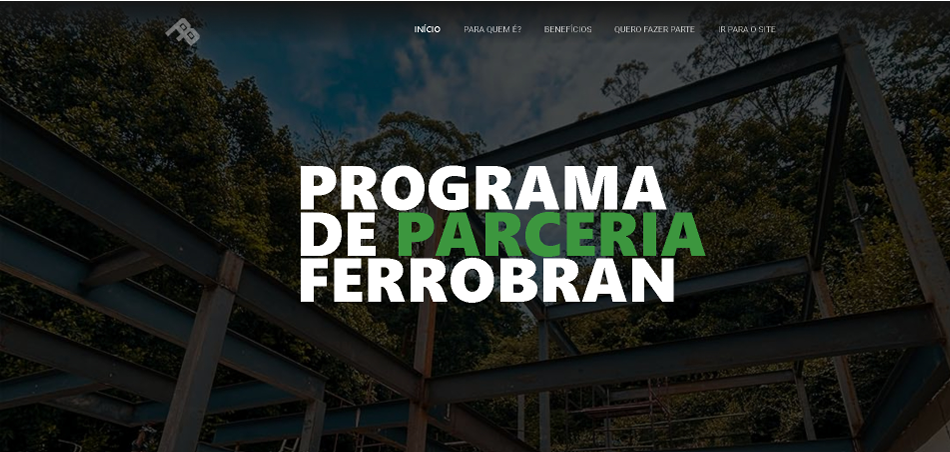
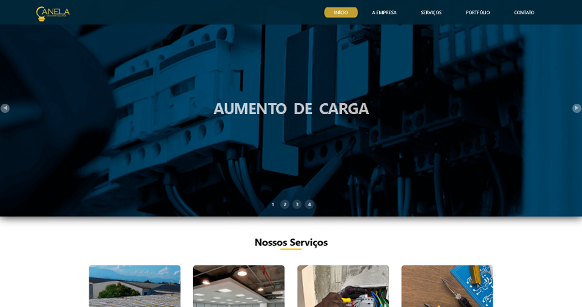

<!-- BANNER PRINCIPAL -->

  

<!-- SOBRE MIM -->

## Sobre mim

Desenvolvedor Web e graduando em Engenharia de Software pela UNINTER, com formação em desenvolvimento Front-end pelo SENAI.

Atuo no desenvolvimento de websites institucionais, landing pages e aplicações web, desde a construção de interfaces até a integração de funcionalidades e publicação.

Tenho experiência com projetos comerciais e utilizo HTML, CSS, JavaScript, Python e Django, direcionando minha formação para o desenvolvimento Full Stack.

<!-- TECH STACK -->

## Tech Stack

<table>
  <tr>
    <td width="330" align="center" valign="middle">
      <strong>Linguagens e frameworks</strong>
    </td>
    <td width="330" align="center" valign="middle">
      <strong>Ferramentas e plataformas</strong>
    </td>
    <td width="140" align="center" valign="middle">
      <strong>Estudando</strong>
    </td>
  </tr>
  <tr>
    <td align="center" valign="middle">
      
    </td>
    <td align="center" valign="middle">
      
    </td>
    <td align="center" valign="middle">
      
    </td>
  </tr>
</table>

<!-- PROJETOS EM DESTAQUE -->

## Projetos em destaque

<table width="960">
  <tr>
    <td width="40%" height="230" valign="middle" align="center">
      
    </td>
    <td width="60%" valign="middle" align="left">
      <h3>Eletrotécnica Marinelli</h3>
      

      Website institucional responsivo com formulários integrados ao Google Apps Script,
      armazenamento de dados em planilhas e notificações automatizadas por e-mail.

      

      
      &nbsp;
      
    </td>
  </tr>
  <tr>
    <td width="40%" height="230" valign="middle" align="center">
      
    </td>
    <td width="60%" valign="middle" align="left">
      <h3>Django Cafeteria</h3>
      

      Aplicação web desenvolvida com Python e Django, voltada à apresentação
      de um catálogo de produtos de uma cafeteria.

      

      
    </td>
  </tr>
  <tr>
    <td width="40%" height="230" valign="middle" align="center">
      
    </td>
    <td width="60%" valign="middle" align="left">
      <h3>Construir com Aço</h3>
      

      Landing page desenvolvida para apresentação do programa de parcerias comerciais
      da Ferrobran Estruturas Metálicas.

      

      
    </td>
  </tr>
  <tr>
    <td width="40%" height="230" valign="middle" align="center">
      
    </td>
    <td width="60%" valign="middle" align="left">
      <h3>Canela Engenharia Elétrica</h3>
      

      Website institucional voltado à apresentação de serviços de engenharia elétrica
      e captação de potenciais clientes.

      

      
    </td>
  </tr>
</table>

<!-- Formação -->

## Formação

<table width="960">
  <tr>
    <td width="160" height="140" align="center" valign="middle">
      
    </td>
    <td width="560" align="left" valign="middle">
      <strong>Engenharia de Software</strong> 
      Centro Universitário Internacional — UNINTER  
      
    </td>
    <td width="240" align="left" valign="middle">
       
      
    </td>
  </tr>
  <tr>
    <td width="160" height="140" align="center" valign="middle">
      
    </td>
    <td width="560" align="left" valign="middle">
      <strong>Programador Front-end</strong> 
      Firjan SENAI — Niterói  
      
    </td>
    <td width="240" align="left" valign="middle">
       
      
    </td>
  </tr>
  <tr>
    <td width="160" height="140" align="center" valign="middle">
      
    </td>
    <td width="560" align="left" valign="middle">
      <strong>Programação em Python</strong> 
      SENAC  
      
    </td>
    <td width="240" align="left" valign="middle">
       
      
    </td>
  </tr>
</table>

<!-- GITHUB STATS -->

## GitHub Stats

  
  

<!-- CONTATOS -->

## Contato

  
  &nbsp;&nbsp;
  
  &nbsp;&nbsp;
  
  &nbsp;&nbsp;
  

